# FreshShare

FreshShare is a mobile app that helps people save surplus food from local bakeries, cafés and restaurants. Shops list "surprise bags" of leftover food at a lower price, and customers reserve a bag and pick it up during the pickup window.

This is my ITC502 Mobile Development Project 2. The app is built with React Native and Expo, based on my Figma design from Project 1.

## Screens

- Splash screen
- Onboarding (3 slides with Next and Skip)
- Login
- Home: search, category filter and list of nearby deals
- Deal details
- Reservation confirmation with pickup code
- Orders: active and past orders
- Favorites
- Nearby map
- Profile

## Screenshots

Taken on an Android phone using Expo Go.

| Splash | Onboarding 1 | Onboarding 2 | Onboarding 3 |
|---|---|---|---|
| 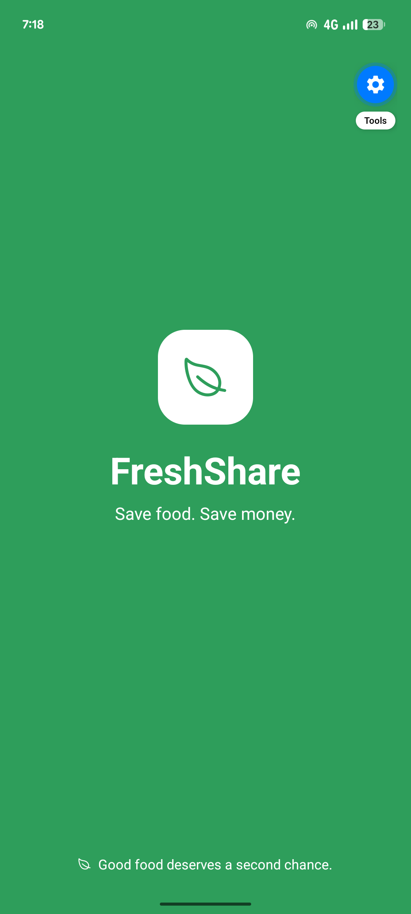 | 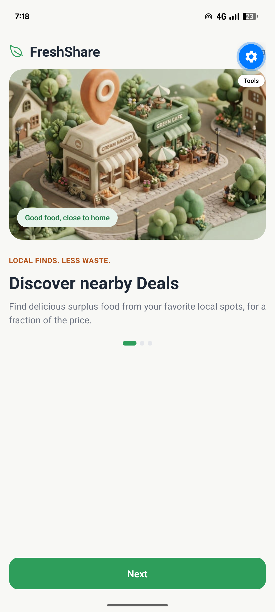 | 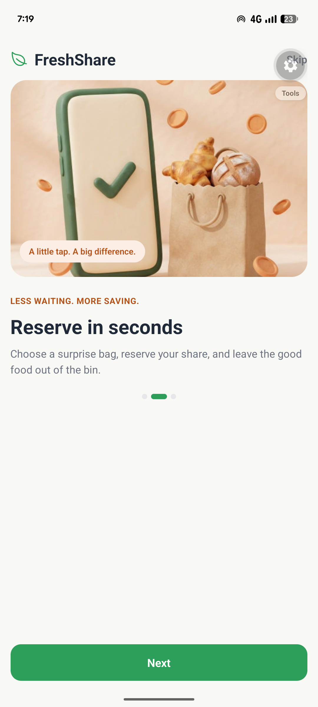 | 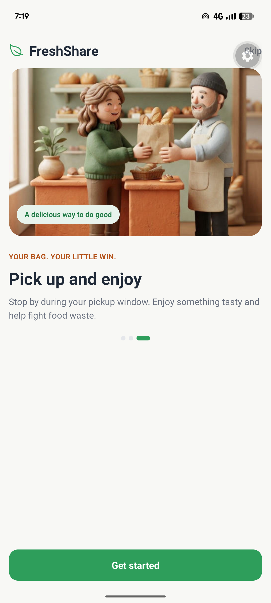 |

| Login | Login check | Home | Search |
|---|---|---|---|
| 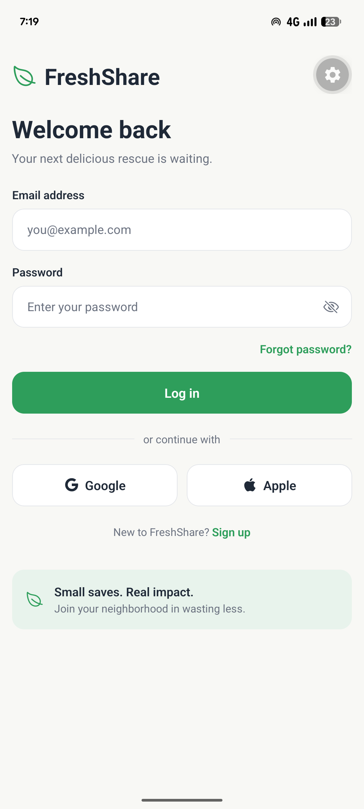 | 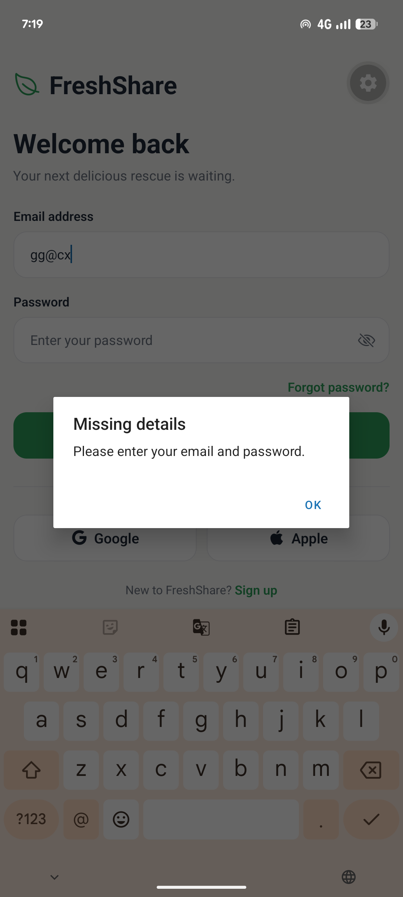 | 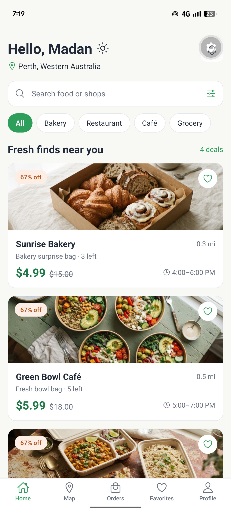 | 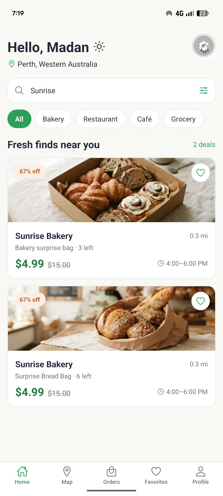 |

| Category filter | Deal details | Reserved | Nearby map |
|---|---|---|---|
| 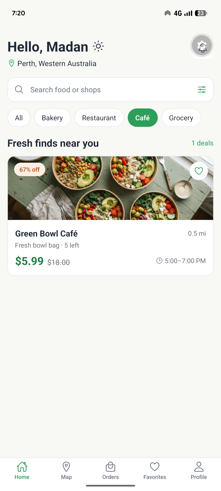 | 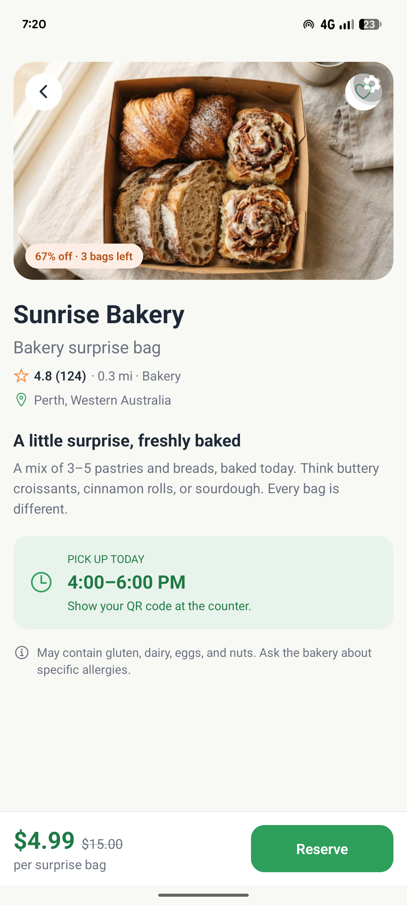 | 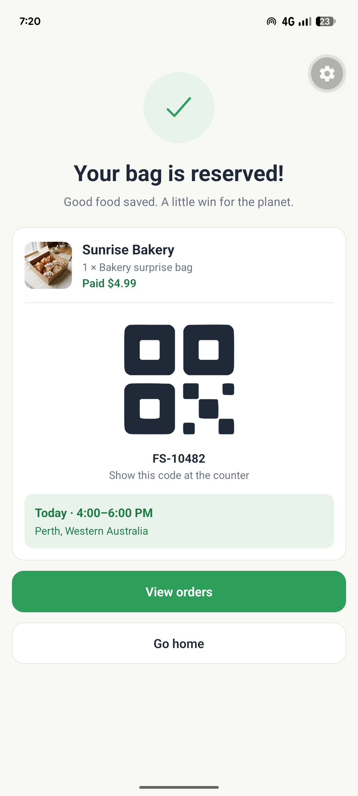 | 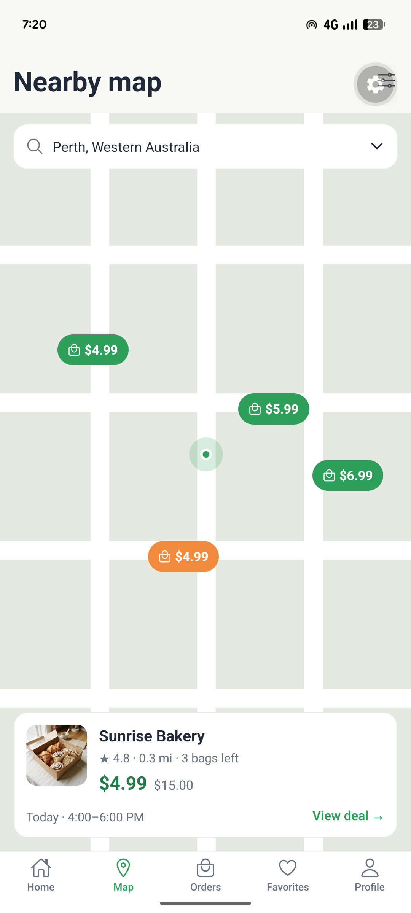 |

| Active orders | Past orders | Favorites | Profile |
|---|---|---|---|
| 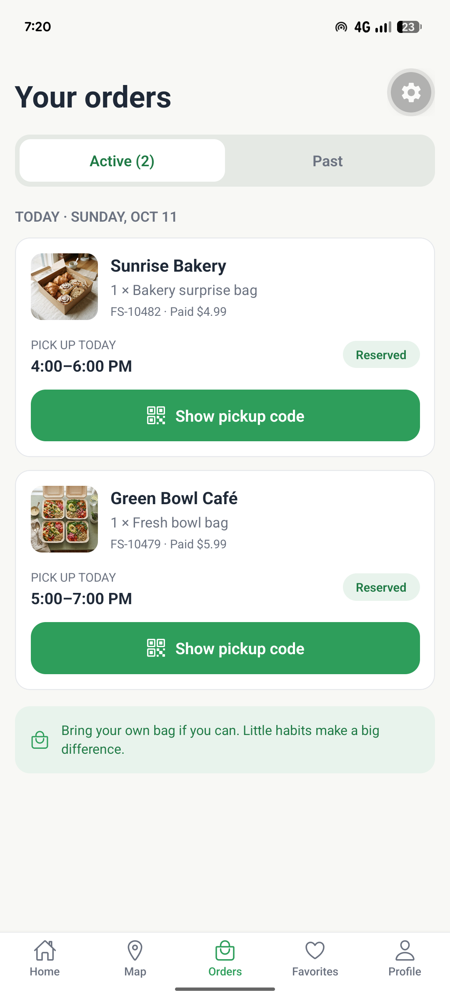 | 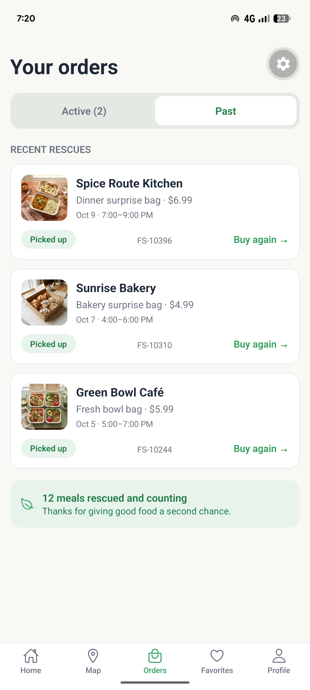 | 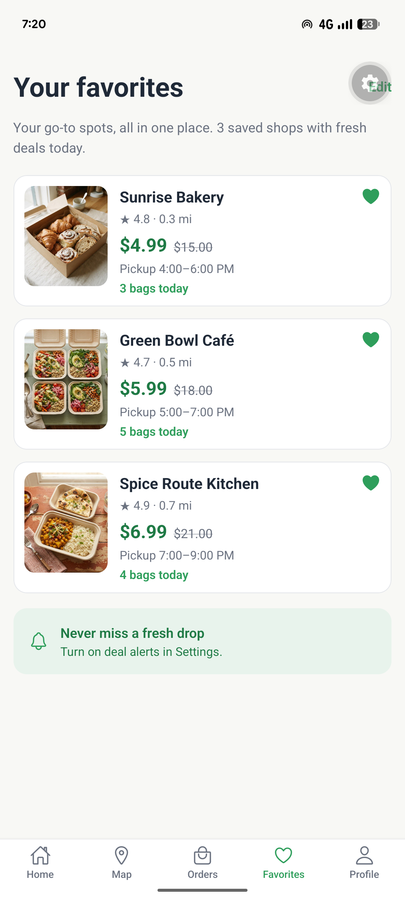 | 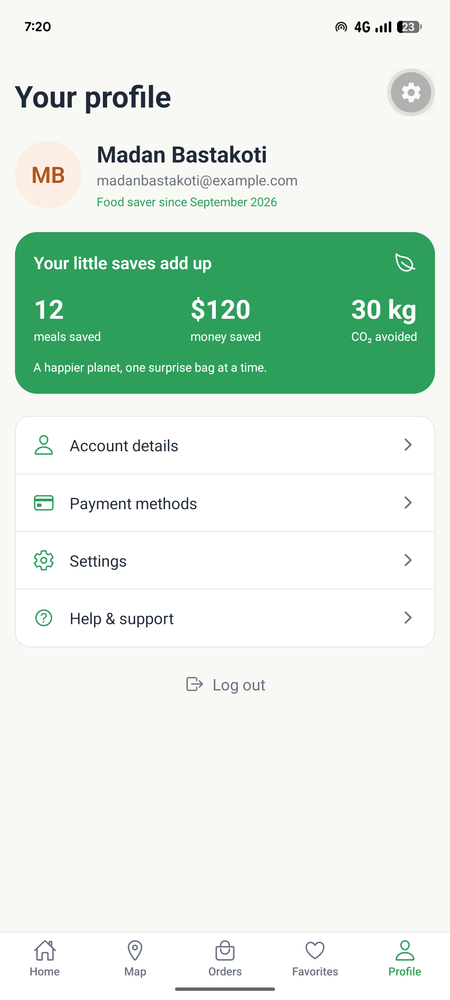 |

| Log out | Coming soon |
|---|---|
| 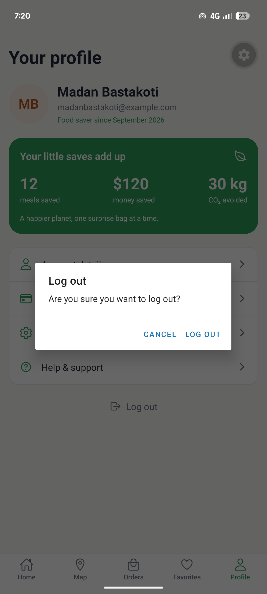 | 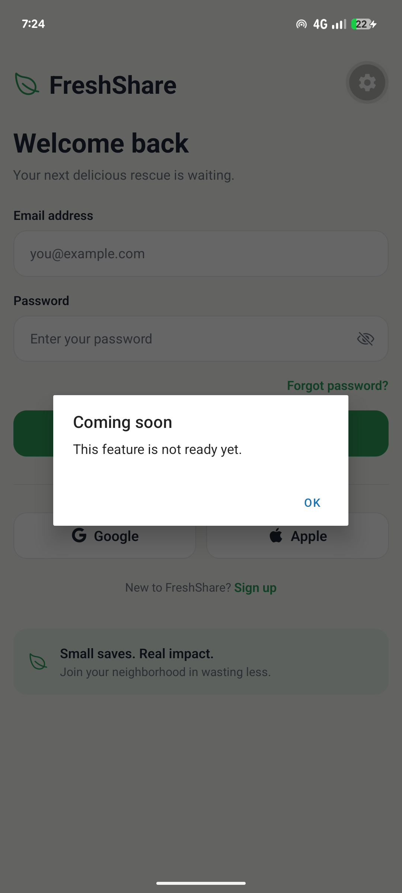 |

## Features

- Navigation with React Navigation (stack + bottom tabs)
- Tap a deal card to open its details
- Search and filter deals by category
- Reserve a bag and see the confirmation screen
- Add or remove favorites with the heart button
- Help & support opens the email app (`mailto` link)
- Show or hide the password on the login screen

## Tech used

- React Native
- Expo (SDK 58)
- React Navigation (native stack and bottom tabs)
- Expo vector icons (Ionicons)

## Project structure

```
FreshShare/
├── App.js
├── assets/
│   └── images/        food photos and onboarding images
└── src/
    ├── components/    reusable UI (buttons, input, deal card, logo)
    ├── constants/     theme.js (colours, spacing, font sizes)
    ├── data/          mock data for deals, orders and user
    ├── navigation/    stack and tab navigators
    └── screens/       all app screens
```

## How to run

1. Install [Node.js](https://nodejs.org/) (LTS version).
2. Clone the repo and install packages:
   ```
   git clone https://github.com/memadan122/FreshShare.git
   cd FreshShare
   npm install
   ```
3. Start the app:
   ```
   npx expo start
   ```
4. Scan the QR code with the **Expo Go** app on your phone, or press `a` to open an Android emulator.

If your phone can't connect on the same Wi-Fi, try `npx expo start --tunnel`.

## Notes

- The app uses mock data in `src/data/`. There is no backend yet.
- The map screen is a simple drawn layout, not a real map.

## Author

Madan Bastakoti
